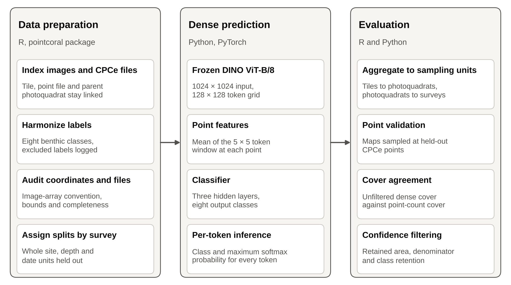

# Mapping mesophotic coral reefs pixel by pixel from legacy point counts

Code, derived data and the trained classifier for

> Cordero, E. and Sherman, C.E. Mapping Mesophotic Coral Reefs Pixel by Pixel from Legacy Point Counts Using DINO Vision Transformer Features. Manuscript submitted for publication.

Monitoring programs have annotated reef photoquadrats with point counts for decades. This repository shows how those point labels can train dense, pixel-level benthic maps without any new annotation. A small classifier is trained on frozen DINO ViT-B/8 features at 53,271 CPCe points from 533 photoquadrats taken at 48–65 m off La Parguera, Puerto Rico, and is then applied to every image token. The maps are compared with the point counts on three held-out surveys, and the effect of confidence filtering on cover estimates is measured.



## Reproduce the results

The tables and figures can be rebuilt from the shared data in `data/` on any laptop. No images or GPU are needed.

```bash
git clone https://github.com/el-cordero/mesophotic-dense-maps.git
cd mesophotic-dense-maps
python -m pip install -r requirements.txt
python workflow/06_analysis.py
python workflow/07_figures.py
```

`06_analysis.py` writes `results/results.json` and Tables 1–9 of the paper as CSV files in `results/tables/`. `07_figures.py` writes Figures 2, 3, 6, 7, 9 and 10 to `outputs/figures/`. Figures 4, 5 and 8 show example tiles and are drawn only when the tile images and prediction rasters are present. Figure 1 (the study area) is not made by these scripts.

With Python 3.13, NumPy 2.5.3, pandas 3.0.5, Matplotlib 3.11.2 and Pillow 12.3.0, the two scripts reproduce the committed `results/results.json` byte for byte and the published figures pixel for pixel. With Python 3.10, NumPy 2.2.6 and pandas 2.3.3, all nine tables are identical and only the simulated sampling error at the survey scale changes, in the fourth significant digit, because the random draws differ between these NumPy versions. The figures use the Liberation Sans font.

## Full workflow

The full workflow starts from the photoquadrat images and CPCe annotations, which are available from the corresponding author on reasonable request. Steps 2 and 3 need a GPU. The study ran them with Python 3.11, PyTorch 2.4.1 and CUDA 12.4 on an NVIDIA H100.

| Step | Script | Input | Output |
|---|---|---|---|
| 1 | `01_prepare_points.R` | pointcoral point table, full-image point files, `data/tiles.csv` | one point file per tile in `tiles/points/` |
| 2 | `02_train_classifier.py` | tile images and point files | classifier checkpoint and training history |
| 3 | `03_predict_tiles.py` | tile images, classifier | class and confidence rasters in `outputs/` |
| 4 | `04_cover_tables.R` | rasters and point files | `data/photoquadrat_cover_by_threshold.csv.gz` |
| 5 | `05_point_predictions.py` | rasters and point files | `data/point_predictions.csv.gz`, `data/photoquadrats.csv` |
| 6 | `06_analysis.py` | `data/`, `models/training_history.csv` | `results/results.json`, `results/tables/` |
| 7 | `07_figures.py` | `results/`, `data/` (and tiles for Figures 4, 5 and 8) | `outputs/figures/` |
| 8 | `08_texture_check.py` | test-tile class rasters | `results/texture_check.json` |

The scripts expect this layout, and every path can be changed with command-line options.

```text
tiles/images/{train,val,test}/<tile>.jpg     tile images (not distributed)
tiles/points/{train,val,test}/<tile>.txt     written by step 1
outputs/predictions/{split}/<tile>.png       written by step 3
outputs/confidence/{split}/<tile>_confidence.png
```

Each photoquadrat was cut into six tiles (two rows by three columns). `data/tiles.csv` gives the crop window, survey and partition of every tile, so the tiles can be cut again from the original images. Data were split by survey, with 11 surveys for training, 2 for validation and 3 for testing.

Install the packages for steps 2 and 3 with

```bash
python -m pip install -r requirements-model.txt
```

and the R packages for steps 1 and 4 with

```r
install.packages(c("pointcoral", "terra", "dplyr", "tidyr", "readr", "stringr", "purrr", "tibble"))
```

The DINO ViT-B/8 weights (Caron et al., 2021) are downloaded from Meta on first use. No random seed was fixed during training, so rerunning step 2 gives slightly different weights. The checkpoint used for every result in the paper is `models/dino_vitb8_point_classifier.pt`.

## Repository contents

```text
config/classes.csv        class IDs, pointcoral class names, display names and colors
data/                     derived tables shared with the paper (see data/README.md)
models/                   trained classifier, class index map and training history
results/                  results.json, Tables 1-9 as CSV and the texture check
src/densemap/             Python package used by steps 2, 3, 6 and 7
workflow/                 the eight steps listed above
```

## Acknowledgments

The ViT definition in `src/densemap/vision_transformer.py` is copied from [CoralSRT](https://github.com/zhengziqiang/CoralSRT) (Zheng et al., 2025), which distributes the DINO implementation of [Caron et al. (2021)](https://github.com/facebookresearch/dino). Label harmonization uses the [pointcoral](https://CRAN.R-project.org/package=pointcoral) R package. The photo-transect surveys were supported by NOAA's Center for Sponsored Coastal Ocean Research through award NA06NOS4780190 to the Caribbean Coral Reef Institute of the University of Puerto Rico–Mayagüez.

## License

The code is released under the MIT License (`LICENSE`). The tables in `data/` and the classifier in `models/` are released under CC BY 4.0. `src/densemap/vision_transformer.py` keeps its original Apache 2.0 header and CoralSRT's MIT license (`LICENSES/`).
